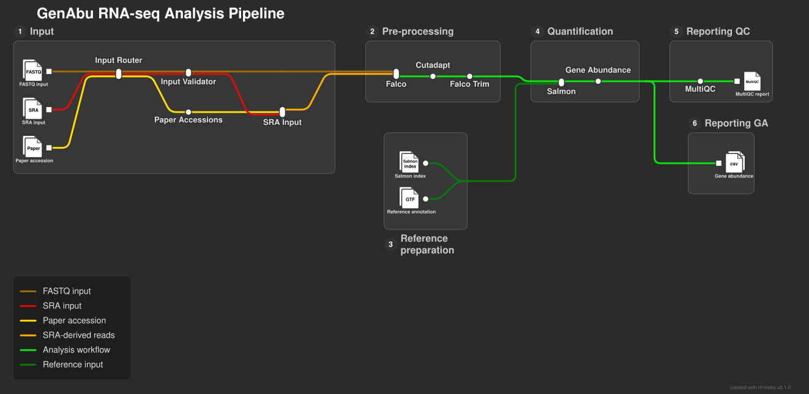

# GenAbu

[](https://github.com/C0ldCl0ud/GenAbu/actions/workflows/test.yml)

**GenAbu** is a Nextflow DSL2 pipeline for processing bulk RNA-sequencing data, from sequencing reads to gene-level abundance tables. It accepts local FASTQ files, Sequence Read Archive (SRA) run accessions, or a research paper in PDF format containing accession identifiers.

GenAbu runs read quality control before and after trimming and collects the results in a MultiQC report. When a reference genome is specified, it also prepares a Salmon index, quantifies transcripts, and combines per-sample gene estimates into count and transcripts-per-million (TPM) matrices.

The pipeline was developed as a computational workflows course project. It aims to provide a small, inspectable example of modular Nextflow workflows, automated testing, and reusable reference data.

## Contents

- [Pipeline overview](#Pipeline-overview)
- [Workflow](#workflow)
- [Requirements](#requirements)
- [Quick start](#quick-start)
- [Input formats](#input-formats)
- [Parameters](#parameters)
- [Output files](#output-files)
- [Reference genomes and caching](#reference-genomes-and-caching)
- [Testing](#testing)
- [Limitations](#limitations)

## Pipeline overview



The diagram summarizes the main processing routes.
Reference preparation and Salmon quantification are only
performed when `--genome` is specified.

## Workflow

GenAbu has three ways to start:

1. **FASTQ samplesheet:** use existing single-end or paired-end compressed FASTQ files.
2. **SRA samplesheet:** provide run accessions; GenAbu downloads and converts the reads.
3. **PDF paper:** extract accession identifiers, resolve them to SRA runs using the accession resolver, and optionally download and process those runs.

Once reads are available, the analysis follows this path:

```text
FASTQ CSV ───────────────────────────────┐
SRA CSV ──────> SRA download/conversion ├──> Falco (raw reads)
PDF ─> accession resolution ─> SRA ────┘            │
                                                     v
                                                  Cutadapt
                                                     │
                           ┌─────────────────────────┴───────────────┐
                           v                                         v
                     Falco (trimmed)                            Salmon quant*
                           │                                         │
                           └──────────────> MultiQC                 v
                                                            Gene count / TPM matrices

* Salmon quantification is run only when --genome is set.
```

The PDF entry point also supports an accession-resolution-only mode that stops before downloading sequencing reads.

## Requirements

- A working **Nextflow** installation and the Java runtime required by that Nextflow version.
- **Docker** to run the pipeline's containerized tools with `-profile docker`.
- Internet access for first-time container pulls, SRA downloads, PDF accession lookup, and reference downloads.
- Sufficient disk space for reads, references, intermediate files, and the Salmon index. Requirements depend on the dataset and genome.

The CI workflow currently uses **Nextflow 26.04.7** on Ubuntu 24.04 and **nf-test 0.9.5**. These are useful versions to reproduce the automated test environment.

## Installation

GenAbu requires Nextflow to orchestrate the workflow and Docker to run the analysis tools. Nextflow can be installed in a dedicated Conda environment using the provided `environment.yml` file.

### Prerequisites

- **Git** to clone the repository.
- **Conda or Miniforge** to manage the Nextflow environment. See the [Miniforge installation guide](https://github.com/conda-forge/miniforge).
- **Docker** to execute containerized analysis tools. Follow the [official Docker installation guide](https://docs.docker.com/get-docker/).

On Windows, we recommend running GenAbu inside **WSL2 (Ubuntu)** with Docker Desktop's WSL2 integration enabled.

### Clone the repository

```bash
git clone https://github.com/C0ldCl0ud/GenAbu.git
cd GenAbu
```

### Create the Conda environment

Create the environment from the provided configuration:

```bash
conda env create -f environment.yml
conda activate genabu
```

The environment installs Nextflow 26.04.7 and its required dependencies, including Java. The Nextflow version matches the version used in the project's continuous integration (CI) tests.

Verify that Nextflow is available:

```bash
nextflow -version
```

### Verify Docker

Docker must be installed and running independently of the Conda environment. Check that Docker is accessible:

```bash
docker --version
docker info
```

### Run GenAbu

With the `genabu` Conda environment activated and Docker running, execute the included test dataset:

```bash
nextflow run . -profile test,docker
```

This performs a real pipeline execution, including downloading required references and containers if they are not already cached. For a lightweight workflow smoke test without executing the analysis tools, use:

```bash
nextflow run . -profile test -stub-run
```

For additional examples and supported input formats, see [Quick start](#quick-start) and [Input formats](#input-formats).

## Quick start

Clone the repository:

```bash
git clone https://github.com/C0ldCl0ud/GenAbu.git
cd GenAbu
```

Run the included test-profile dataset with Docker and the yeast reference:

```bash
nextflow run . -profile test,docker
```

> The test profile sets `--input` to `tests/data/samplesheet.csv`, `--genome` to `yeast`, and local-process resources to 1 CPU and 1 GB. It does **not** automatically enable `-stub-run`. A full run executes the actual tools; for a lightweight workflow smoke test, use `nextflow run . -profile test -stub-run`.

To analyze your own FASTQ samplesheet with a supported reference:

```bash
nextflow run . -profile docker \
  --input samplesheet.csv \
  --genome mouse
```

For quality control and trimming **without** Salmon quantification:

```bash
nextflow run . -profile docker --input samplesheet.csv
```

For a PDF paper, resolve accessions but do not download reads:

```bash
nextflow run . -profile docker \
  --input paper.pdf \
  --resolve_only \
  --max_runs 20
```

To continue an interrupted execution, Nextflow supports `-resume`; note that `-resume` is a Nextflow command-line option, not a GenAbu parameter.

## Input formats

Provide exactly one `--input` path pointing to either a `.csv` samplesheet or a `.pdf` paper. The input router checks the extension and verifies the PDF file signature. CSV input types are identified by their headers.

### FASTQ samplesheet

```csv
sample,fastq_1,fastq_2
sampleA,/data/sampleA_R1.fastq.gz,/data/sampleA_R2.fastq.gz
sampleB,/data/sampleB.fastq.gz,
```

- `sample`: unique sample identifier, without whitespace.
- `fastq_1`: path to a compressed `.fastq.gz` or `.fq.gz` file.
- `fastq_2`: mate-2 file for paired-end reads; leave the field empty for single-end data.

The FASTQ header must contain all three columns, including `fastq_2`, even when reads are single-end. Additional columns and different column ordering are accepted. FASTQ paths must exist and must not contain whitespace.

### SRA samplesheet

```csv
sample,accession
sampleA,SRR1234567
sampleB,ERR1234567
```

- `sample`: unique sample identifier without whitespace.
- `accession`: an SRA/ENA/DDBJ run accession starting with `SRR`, `ERR`, or `DRR`, followed by digits.

GenAbu uses the SRA Toolkit to prefetch and convert the accession into FASTQ reads. A CSV with both FASTQ and SRA-specific headers is rejected as ambiguous.

### PDF paper

```bash
nextflow run . -profile docker \
  --input article.pdf \
  --resolve_only
```

The PDF route converts the paper to text, searches for accession identifiers, and attempts to resolve them to sequencing-run records. Results include resolved and unresolved accession tables, plus a reusable SRA samplesheet. The resolver can fail to identify usable runs in papers that omit accessions or provide identifiers it cannot resolve; not every PDF will produce a runnable dataset.

Remove `--resolve_only` to proceed from resolved run accessions to read processing. Add `--genome` if gene-level quantification is also required.

## Parameters

| Parameter | Default | Purpose |
| --- | --- | --- |
| `--input` | Required | `.csv` FASTQ/SRA samplesheet or `.pdf` paper. |
| `--genome` | Unset | Reference identifier or alias; enables Salmon quantification and gene matrices. |
| `--resolve_only` | `false` | Stop after the paper-accession resolution stage. |
| `--max_runs` | `20` | Maximum number of sequencing runs to resolve from a paper (minimum 1). |
| `--reference_cache` | `~/.cache/genabu/references` | Location of the persistent reference cache. |
| `--adapter_r1` | `AGATCGGAAGAGC` | Cutadapt 3′ adapter for read 1. |
| `--adapter_r2` | `AGATCGGAAGAGC` | Cutadapt 3′ adapter for read 2. |
| `--quality_cutoff` | `20` | Cutadapt Phred quality cutoff. |
| `--minimum_length` | `20` | Minimum read length retained after trimming. |

The parameters are defined by `nextflow_schema.json` and `nextflow.config`. The available profiles are `test` and `docker`; combine them as `-profile test,docker` where appropriate.

**Note:** There is currently no `--outdir` parameter. Published results go into fixed directories named `results/` relative to the launch directory.

## Output files

Outputs depend on the input and whether a reference genome was supplied.

| Path | When produced | Contents |
| --- | --- | --- |
| `results/multiqc/multiqc_report.html` | Read processing | MultiQC summary of raw/trimmed Falco and Cutadapt metrics; includes Salmon inputs when quantification runs. |
| `results/multiqc/multiqc_data/` | Read processing | Data exported by MultiQC. |
| `results/multiqc/multiqc_plots/` | When plots are generated | MultiQC plot files (optional output). |
| `results/gene_counts.tsv` | With `--genome` | Gene-by-sample table of Salmon `NumReads` estimates. Values may be fractional; they are not necessarily integer read counts. |
| `results/gene_abundance.tsv` | With `--genome` | Gene-by-sample table of Salmon gene-level TPM estimates. |
| `results/pipeline_info/software_versions.yml` | Workflow | Collected software version information. |
| `results/paper_resolve/` | PDF input | Resolved/unresolved accession tables and resolver information. |
| `results/samplesheet.csv` | PDF input | Generated run-level SRA samplesheet. |

The count and TPM matrices use **gene identifiers** in the first column and sample IDs as subsequent columns.

## Reference genomes and caching

Supported aliases and reference URLs are maintained in [`assets/references.yml`](assets/references.yml). The current catalogue includes:

| `--genome` | Organism | Assembly | Source |
| --- | --- | --- | --- |
| `human` | *Homo sapiens* | GRCh38 | Ensembl release 116 |
| `mouse` | *Mus musculus* | GRCm39 | Ensembl release 116 |
| `yeast` | *Saccharomyces cerevisiae* | R64-1-1 | Ensembl release 116 |

Aliases such as `GRCh38`, `Mus musculus`, and `s288c` are also supported as defined in the catalogue.

Reference preparation downloads the genome FASTA and gene annotation (GTF), produces a transcriptome, and builds a Salmon index. These artifacts are stored under the configured reference-cache directory so later runs can reuse them. The index cache path includes the Salmon version and k-mer length (`salmon-2.7.0-k31`).

The implementation performs lightweight cache checks before reuse. These checks are not checksums or a full integrity audit, so a successful cache lookup should not be interpreted as complete verification of its contents.

## Testing

The project uses **nf-test** for Nextflow process, subworkflow, and workflow tests, plus Python unit tests for supporting scripts. GitHub Actions runs on pushes and pull requests.

Run the CI-tagged nf-test suite locally:

```bash
nf-test test --tag ci --ci
```

Run the pipeline smoke test without real downloads or quantification:

```bash
nextflow run . -profile test -stub-run
```

Run Python unit tests:

```bash
python3 -m unittest discover -s tests/unit -p 'test_*.py' -v
```

Some integration tests use actual containers and are tagged separately; they are not included merely by running the stub-mode smoke test. See the `tests/` directory and [CI workflow](.github/workflows/test.yml) for the current test configuration.

## Limitations

- GenAbu focuses on read preprocessing and **Salmon-based quantification**. It does not perform genome alignment, differential expression analysis, or interpretation of expression changes.
- The supported reference catalogue currently contains human, mouse, and yeast. Other organisms require changes to the reference configuration.
- The PDF route depends on finding and resolving public accessions in the provided paper; success is not guaranteed for every publication.
- Reference reuse is based on lightweight file checks, and simultaneous runs sharing one cache have not been established as concurrency-safe.
- Results use fixed publication paths. Running multiple analyses from the same launch directory can overwrite published outputs; use separate launch directories when you need to preserve multiple result sets.

## Project

Source code, issues, and development history: [C0ldCl0ud/GenAbu](https://github.com/C0ldCl0ud/GenAbu).
